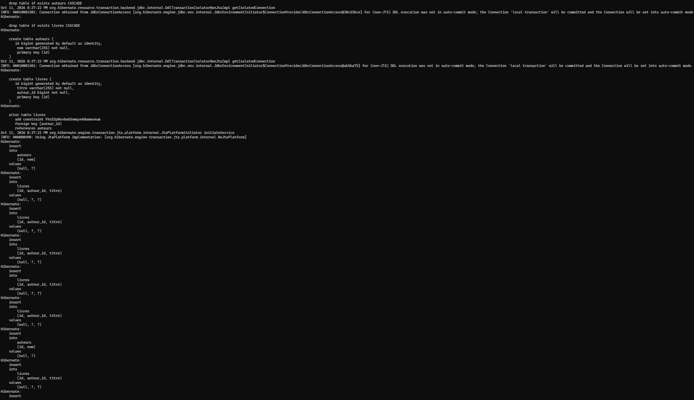
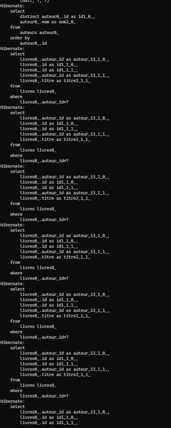
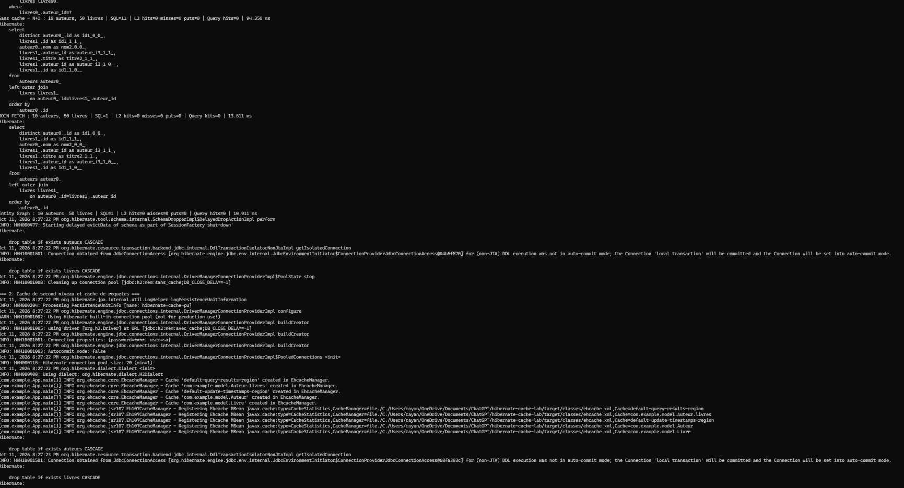
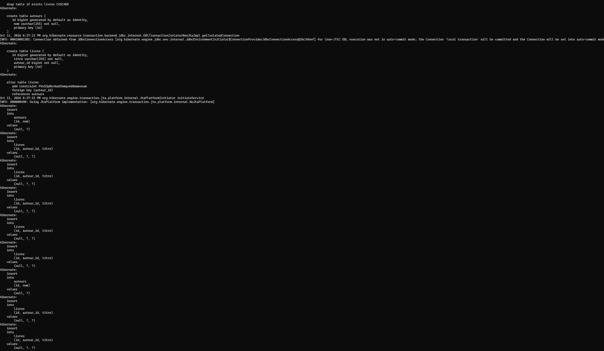
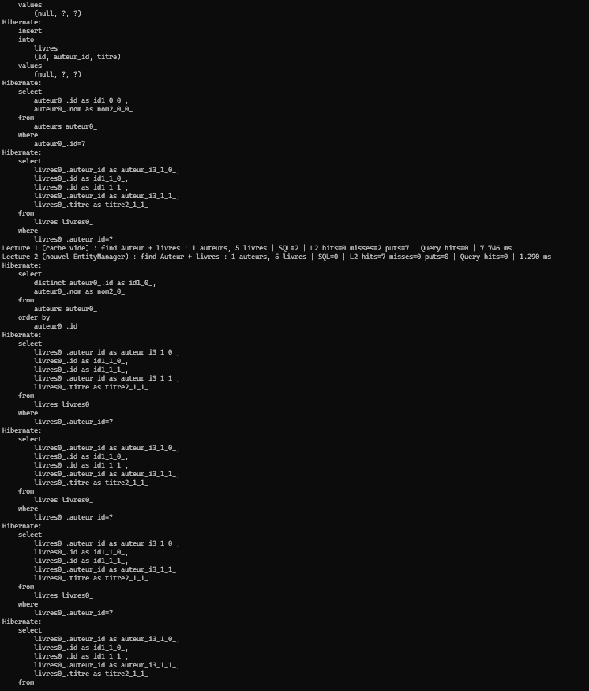
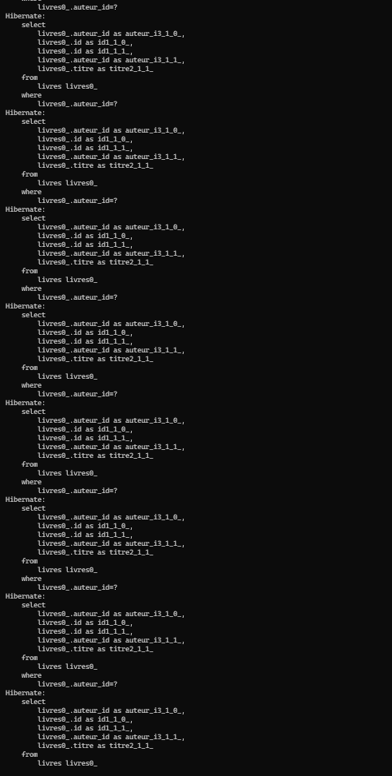
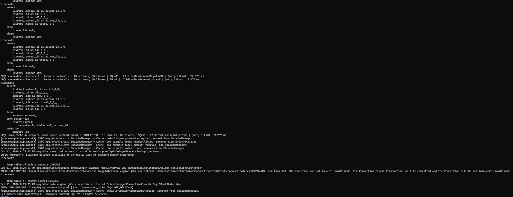

# TP 7 — Cache de second niveau, JOIN FETCH et Entity Graph

**Réalisé par :** Ali Mahraoui

## Exécutions

### Exécution 1 — Initialisation de la base sans cache

### Exécution 2 — Problème N+1 : une requête par auteur

### Exécution 3 — Comparaison N+1, JOIN FETCH et Entity Graph

### Exécution 4 — Initialisation de la base avec cache de second niveau

### Exécution 5 — Lecture par identifiant : cache L2 froid puis chaud

### Exécution 6 — Requête JPQL cacheable : chargement paresseux des livres

### Exécution 7 — Cache de requêtes et JOIN FETCH non cacheable

